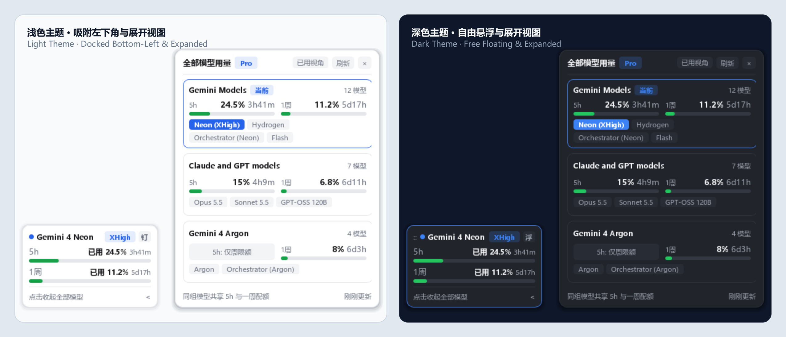
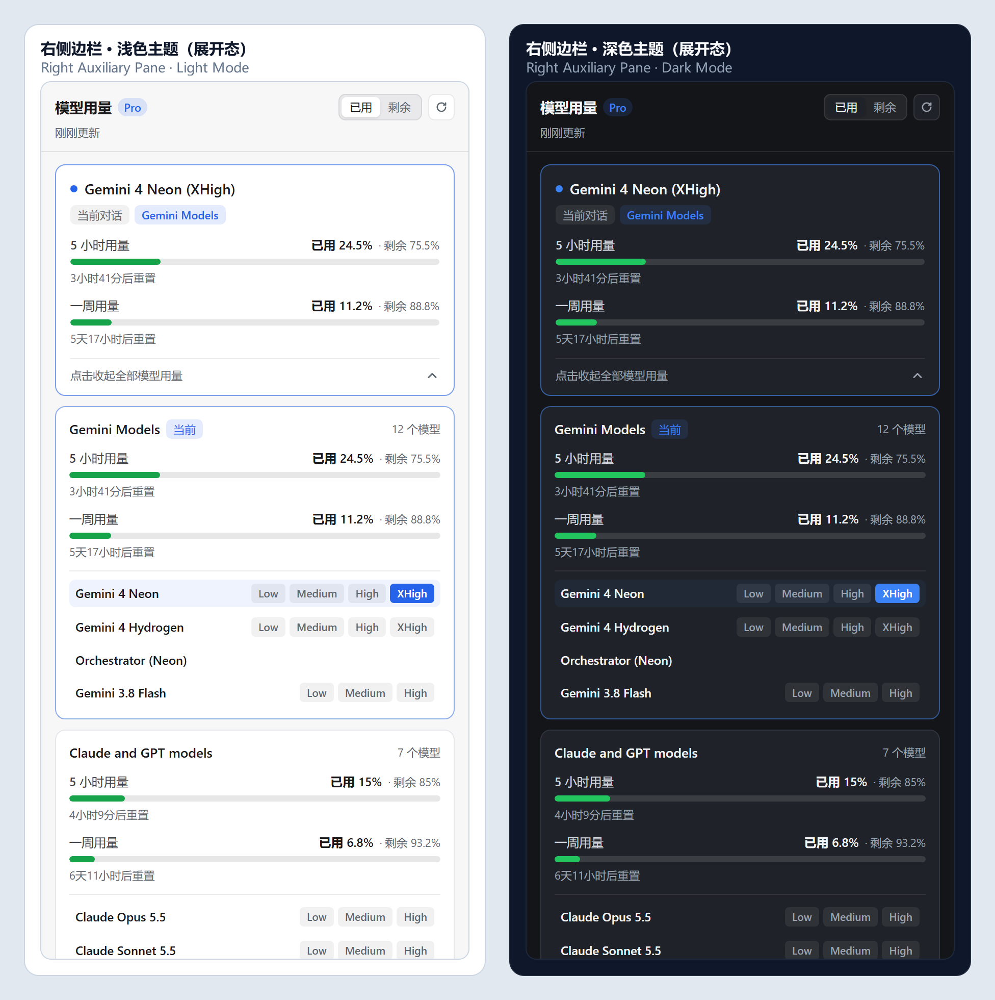
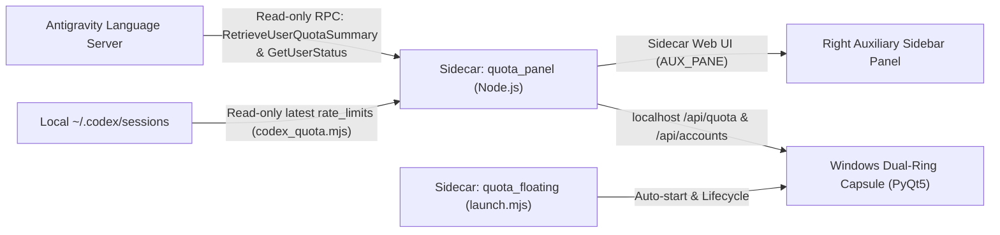

<div align="center">


# Antigravity + Codex Model Quota Monitor

**极简任务栏双环定制版 · 实时监控 Google Antigravity（Gemini）与 OpenAI Codex 配额 · 零 Token 消耗**

[](https://github.com/doob1993622/antigravity-quota-monitor)
[-16a34a?style=flat-square)](https://github.com/doob1993622/antigravity-quota-monitor)
[](https://github.com/doob1993622/antigravity-quota-monitor)
[](LICENSE)

[界面预览](#preview) · [核心特性](#features) · [快速安装](#install) · [快捷操作](#controls) · [工作原理](#architecture) · [致谢](#credits)

</div>

---

<a id="preview"></a>
## ✨ 界面预览

### 1. Windows 极简双环胶囊 + 悬停详情弹窗（随 Antigravity 自动启停）
- **合并到任务栏 / 随时单拎悬浮**：按住胶囊拖进底部任务栏即可自动透明融合并智能避让托盘图标；往上拖出任务栏即刻还原为桌面圆角悬浮球。
- **双平台同屏监控**：左环为 **Antigravity（Gemini）** 拱形 A 标，右环为 **OpenAI Codex** 六瓣结；外环显示 **5h 用量**，右侧两行依次显示 **周用量** 与 **5h 下次重置倒计时**。
- **丝滑悬停交互**：鼠标悬停自动弹出精简双卡详情（不抢占输入焦点），挪开自动隐藏；点击顶栏图钉即可常驻置顶，点击单张卡片右上角图钉可自由控制是否在胶囊上显示（取消一个后自动收缩为单环迷你胶囊）。



### 2. 右侧辅助边栏面板（全平台通用）
在对话右上角 **`+`** 菜单中选择 **`模型用量`** 即可打开，开箱即用、无需额外 Python 依赖。



---

<a id="features"></a>
## 🎯 核心特性

| 功能维度 | 右侧辅助边栏面板 (`quota_panel`) | Windows 双环胶囊浮窗 (`quota_floating`) |
| :--- | :--- | :--- |
| **支持平台** | Windows / macOS / Linux 全平台 | Windows（需 Python 3.9+ & `PyQt5`） |
| **监控范围** | Google Antigravity（Gemini）+ 本机 OpenAI Codex | 同左，双环一屏直出 5h 环、周用量与 5h 重置倒计时 |
| **停靠与形态** | 紧贴客户端右侧辅助栏，自动跟随主题 | 支持 **合并到任务栏** / **桌面自由悬浮** / **吸附左下角**，拖拽即可无缝切换 |
| **弹窗交互** | 展开查看完整分组与多账号切换 | **鼠标悬停自动弹出**、挪开自动消失；顶栏图钉可常驻，卡片图钉可自定义胶囊显示项 |
| **视角切换** | 顶部 `已用 / 剩余` 分段按钮 | 弹窗内**单击任意百分比**一键切换已用/剩余，或通过暗黑圆角右键菜单切换 |
| **多账号管理** | 支持本地账号快照保存、备注、导入/导出与一键切换 | 顶栏人像图标一键切入账号管理页 |
| **额外 Token 消耗** | **0 Token**（纯本地只读接口 & 本地日志） | **0 Token**（复用 `quota_panel` Sidecar 本地 HTTP 缓存） |

---

<a id="install"></a>
## 🚀 快速安装

### 1. 安装插件（任选一种方式）

* **方式一：使用 `agy` CLI 一键安装（推荐）**
  ```bash
  agy plugin install https://github.com/doob1993622/antigravity-quota-monitor
  ```

* **方式二：使用 `git clone` 克隆到插件目录**
  * **Windows (PowerShell)**：
    ```powershell
    git clone https://github.com/doob1993622/antigravity-quota-monitor.git "$env:USERPROFILE\.gemini\config\plugins\quota-monitor"
    ```
  * **macOS / Linux**：
    ```bash
    git clone https://github.com/doob1993622/antigravity-quota-monitor.git ~/.gemini/config/plugins/quota-monitor
    ```

* **方式三：手动下载 ZIP**
  下载仓库压缩包解压并重命名为 `quota-monitor`，放至 `~/.gemini/config/plugins/quota-monitor/`（确保 `plugin.json` 直接位于该目录下）。

### 2. 开启 Windows 任务栏 / 桌面双环胶囊浮窗（可选）

右侧边栏面板无需任何额外依赖；如需开启 Windows 双环胶囊浮窗，仅需安装 `PyQt5`：

```bash
pip install PyQt5
```

1. **重启一次 Antigravity**（或在左侧「个性化定制」中重新开关一次插件），浮窗会自动随客户端启停。
2. 如将 `PyQt5` 装在独立虚拟环境（如其他盘的 `.venv`），可设置用户环境变量 `ANTIGRAVITY_QUOTA_PYTHON` 指向该环境的 `pythonw.exe`。
3. 未安装 `PyQt5` 或在 macOS / Linux 下运行时会自动跳过，不影响右侧边栏面板正常使用。

---

<a id="controls"></a>
## 🖱️ 快捷操作与交互

| 入口 | 操作 | 效果 |
| :--- | :--- | :--- |
| **双环胶囊** | **鼠标悬停** | 自动弹出精简双卡详情（不抢焦点），鼠标挪开自动消失 |
| **双环胶囊** | **左键轻点左/右舱** | 一键唤醒或启动对应的 **Antigravity** / **OpenAI Codex** 桌面端 |
| **双环胶囊** | **拖入任务栏 / 向上拖出** | 拖进任务栏自动透明融合并避让托盘图标；往上拖出还原桌面圆角悬浮球 |
| **双环胶囊** | **右键单击** | 打开暗黑圆角快捷菜单（位置切换、视角切换、偏好设置、刷新、退出） |
| **悬停弹窗顶栏** | **人像 / 刷新 / 图钉 图标** | 分别对应：切换账号管理页、立即刷新、切换弹窗常驻置顶 |
| **悬停弹窗卡片** | **右上角小图钉** | 控制该模型是否固定在胶囊上显示（取消后胶囊自动收缩为单环） |
| **悬停弹窗数值** | **单击百分比数字** | 一键切换「已用视角 / 剩余视角」（悬停可看精确重置时间） |
| **右侧边栏面板** | **对话右上角 `+` → `模型用量`** | 打开右侧边栏完整视图 |

---

<a id="architecture"></a>
## 🧠 工作原理（纯本地 · 零 Token 消耗）



- **Antigravity 配额**：只读调用本地 Language Server 的 `RetrieveUserQuotaSummary` / `GetUserStatus` 接口，带 10 秒缓存。
- **OpenAI Codex 配额**：只读扫描本机 `~/.codex/sessions/` 最新会话日志里的 `rate_limits` 快照，窗口过期自动归零。
- **纯本地隐私运行**：所有数据与账号凭据均仅留在本地，不向任何第三方服务器上传数据。

---

<a id="credits"></a>
## 🙏 致谢与协议

本项目 Fork 自 [jibunrock40/antigravity-quota-monitor](https://github.com/jibunrock40/antigravity-quota-monitor)，在此基础上进行了 UI 极简化重构、任务栏融合交互及 OpenAI Codex 配额集成。

遵循 [MIT License](LICENSE) 开源协议。
